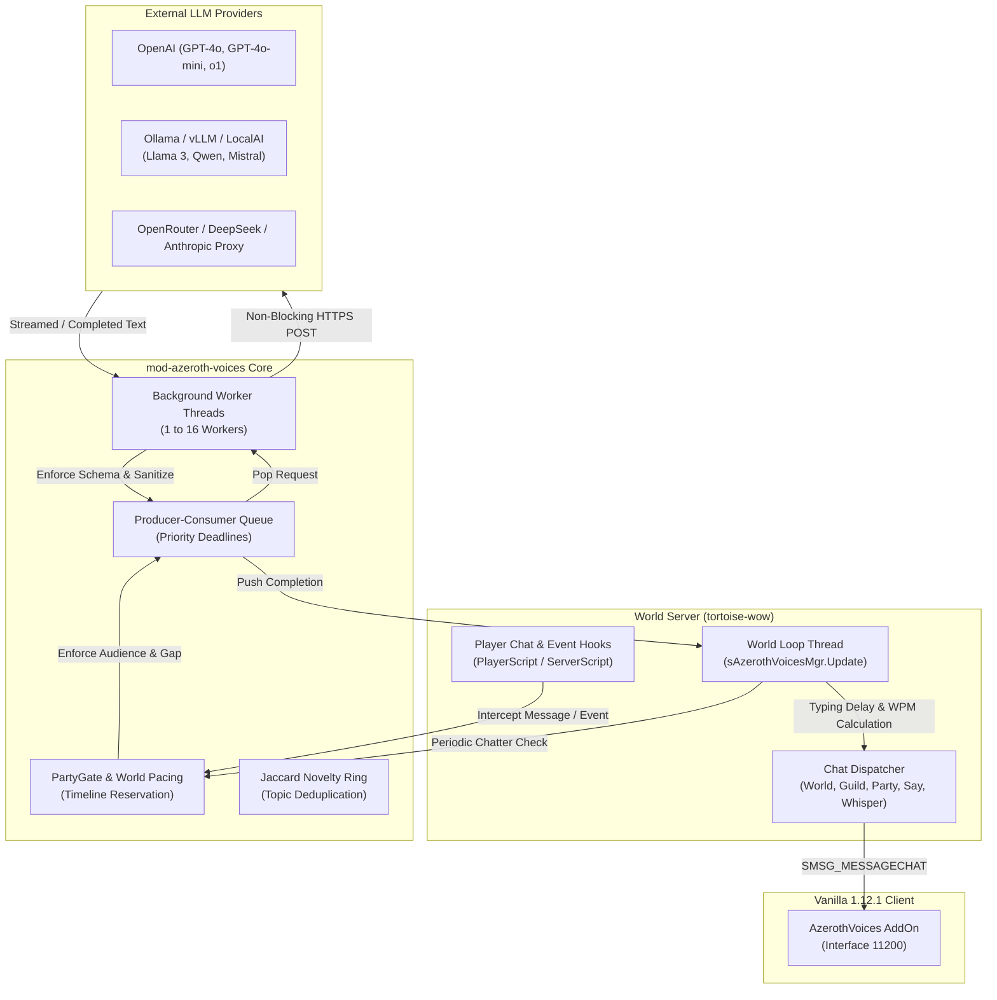

# Azeroth Voices — In-Process LLM Conversational Engine

[-blue.svg)](https://github.com/Ildourol/mod-twow-azeroth-voices)
[](https://turtle-wow.org)
[]()
[]()
[]()
[]()


**Azeroth Voices** is an autonomous, zero-bridge, native C++ conversational AI module designed specifically for custom Turtle WoW and vMaNGOS (`tortoise-wow` targeting client 1.18.1 build 7272 and Vanilla 1.12.1 build 5875).

By directly embedding an asynchronous non-blocking HTTP/HTTPS provider client into the worldserver, **Azeroth Voices completely eliminates the need for external Python bridges, socket middleware, or inter-process communication (IPC) overhead**. Supported PlayerBots (via `TortoiseBots`) and NPCs converse with real players, react dynamically to world combat events, maintain persistent personality backstories, and participate in authentic Vanilla-era Barrens World Chat banter.

> [!NOTE]
> This is an open-source community module designed for custom private server architectures. It is strictly encapsulated in module space and adheres to **The Unediting Doctrine** (zero modifications to core engine sources).

---

## Table of Contents

- [Overview & Architecture Highlights](#overview--architecture-highlights)
- [Core Features](#core-features)
- [Barrens World Chat Banter System](#barrens-world-chat-banter-system)
- [System Architecture & Data Flow](#system-architecture--data-flow)
- [System Requirements & Compatibility](#system-requirements--compatibility)
- [Installation & Build Guide](#installation--build-guide)
- [Database Setup & Schema Migrations](#database-setup--schema-migrations)
- [Configuration & Deployment](#configuration--deployment)
- [Configuration Presets & Quick-Start](#configuration-presets--quick-start)
- [In-Game Administration Commands](#in-game-administration-commands)
- [Client Companion AddOn](#client-companion-addon)
- [Troubleshooting & Diagnostics](#troubleshooting--diagnostics)
- [Contributing & Code Standards](#contributing--code-standards)

---

## Overview & Architecture Highlights

| Architectural Seam | Implementation Paradigm | Operator Benefit |
| :--- | :--- | :--- |
| **Execution Engine** | In-process native C++17 with background worker thread pool | Zero Python dependencies, zero subprocess IPC latency, instant restarts. |
| **Network Transport** | Asynchronous non-blocking HTTP/HTTPS via vendored `cpp-httplib` + OpenSSL | World thread never stalls waiting for LLM completions; resilient socket pooling. |
| **Core Immutability** | 100% decoupled module space using native vMaNGOS lifecycle hooks | Zero edits or patches to core engine (`tortoise-wow`) or AI engine (`TortoiseBots`). |
| **Token Budgeting** | Dynamic Token Range (Mode 2) + Adaptive Proportional Prompt Guidance | Eliminates mid-sentence clipping on low token rolls while expanding on higher rolls. |
| **Persona Persistence** | Dedicated `characters` database tables with unbounded `TEXT` backstory storage | Full bot memory retention across realm restarts with active voice prompt pruning. |
| **Audience Gating** | Zero-Audience Protection & Player Courtesy Silence Windows | Bots never speak to empty servers and yield channels when human players are chatting. |

---

## Core Features

### 1. Direct Multi-Scope Dialogue
- **Whispers, Say, Yell**: Realistic 1-on-1 player conversation with spatial proximity falloff (Say: 25yd, Yell: 100yd).
- **Party & Raid Communications**: Context-aware dungeon chatter, mana warnings, boss mechanics reactions, wipe consolations, and celebratory cheers.
- **Guild Chat**: Shared guild banter, congratulations on milestones, and guild dungeon coordination.
- **World & Custom Channels**: Realistic realm-wide discussions, trade queries, and server banter.

### 2. Authentic Vanilla Barrens World Chat Engine
- **Sequential Multi-Bot Scenes**: Coordinates 3–5 PlayerBots across 6–15 turns on the public World channel (`ChatScope::World`).
- **6 Discourse Families & 108 Curated Variants**: Class salt, absurd bait (Chuck Norris memes), quest memes (Mankrik's Wife, zebra hooves), loot drama (hunter weapons), old MMO debates (EverQuest vs WoW), and server life (lag, zeppelins).
- **Hybrid AI Premise Generation**: Features `RequestKind::BarrensTopicGeneration` asynchronously proposing novel topic angles via JSON schemas, falling back gracefully to curated seeds.
- **Dynamic Conversational Beats**: Dynamic selection among direct replies, short reactions, topic derails, and third-party interruptions.
- **3-Axis Tone Tuple Model**: Independent `(salt, sarcasm, toxicity)` levels sampled per bot with per-turn re-roll chances.
- **Jaccard Lexical Novelty Ring**: In-memory token overlap ring filter preventing repetitive discussion topics within configurable time windows.

### 3. Persistent Personalities & Self-Gating Backstories
- **Active Voice Layer (~25 tokens)**: Injects compact traits, tone, and behavioral priority rules without consuming excessive context.
- **Self-Gating Backstory Architecture**: SQL-persisted biographies (`TEXT`) evaluated natively by the LLM via a zero-latency prompt directive (*"Keep private: only mention if explicitly asked"*), saving 35–50% context tokens during routine combat and ambient events.

### 4. 6-Category Human Dialogue Variety
- Idle banter and ambient remarks dynamically sample across:
  - **Entertainment**: In-universe jokes, tavern humor, playful teasing.
  - **Toxic Gamer Salt**: Competitive complaints, roasting bad play, wipe frustration.
  - **Real Life / News**: Late-night fatigue, snacks, coffee, pets walking on keyboards.
  - **Tactical Calls**: Patrol alerts, mana checks, target focus, buff reminders.
  - **Warcraft Lore**: Zone history, ancient wars, faction rivalries.
  - **Inquiries / Questions**: Practical questions that trigger other bots in the party or world channel to chim in and answer.

### 5. Dynamic Token Budgeting & Adaptive Length
- **Mode 2 Dynamic Roll**: Randomly rolls token budgets between `MinTokens` (default 20) and `MaxTokens` (default 100) per dialogue turn.
- **Adaptive Prompt Guidance**: Dynamically appends proportional brevity instructions (`Short`, `Medium`, `Long`) to align output volume with the assigned budget.
- **Short Greeting Capping**: Automatically clamps token budgets to 25 and max lines to 1 when short greetings like *"hi"*, *"yo"*, *"sup"*, or *"rdy"* are detected.

### 6. PartyGate Pacing & Anti-Spam Protections
- **Timeline-Based Delivery Queues**: Categorizes messages into Filler, Contextual, Responsive, and Urgent queues to prevent wall-of-text spam.
- **Speaker Rotation Penalty**: Soft penalties discourage the last bot that spoke from immediately answering again, ensuring diverse party member participation.
- **Human Priority Courtesy**: Automatically silences bot World chatter for 45s whenever a real human player speaks in the channel.

---

## System Architecture & Data Flow



---

## System Requirements & Compatibility

### Server Engine
- **Core Engine**: Custom Turtle WoW vMaNGOS (`tortoise-wow` targeting client 1.18.1 build 7272).
- **Companion AI Engine**: `TortoiseBots` (built with `BUILD_PLAYERBOTS=ON`).
- **C++ Standard**: C++17 compliant compiler (MSVC 2022+ on Windows, GCC 11+ or Clang 13+ on Linux).
- **Dependencies**: OpenSSL 1.1.1+, zlib, CMake 3.16+.

### Supported LLM Backends
`mod-azeroth-voices` natively connects to any OpenAI Chat Completions-compatible API endpoint:
- **Cloud Providers**: OpenAI (`gpt-4o-mini`, `gpt-4o`), OpenRouter, DeepSeek, Mistral AI.
- **Self-Hosted / Local LLMs**: [Ollama](https://ollama.com) (`llama3.2`, `qwen2.5`, `mistral`), [vLLM](https://github.com/vllm-project/vllm), LocalAI, LM Studio.

### Client Environment
- Compatible with Turtle WoW 1.18.1 (Build 7272) and classic Vanilla 1.12.1 (Interface 11200).
- Optional companion interface: `client/AzerothVoices` (Lua 5.0 compliant, zero-BOM).

---

## Installation & Build Guide

### 1. Clone the Module
Place the repository into your server's `modules/` directory:

```bash
cd /path/to/server/source/modules
git clone https://github.com/Ildourol/mod-twow-azeroth-voices.git
```

### 2. Configure CMake
Reconfigure CMake to build the server with PlayerBots and Azeroth Voices enabled:

#### Linux (Ubuntu / Debian):
```bash
cd /path/to/server/build
cmake ../ \
  -DCMAKE_BUILD_TYPE=Release \
  -DBUILD_PLAYERBOTS=ON \
  -DMODULE_MOD_AZEROTH_VOICES=static
cmake --build . --config Release -j$(nproc)
```

#### Windows (PowerShell / Visual Studio 2022):
```powershell
cd C:\path\to\server\build
cmake .. -G "Visual Studio 17 2022" -A x64 `
  -DBUILD_PLAYERBOTS=ON `
  -DMODULE_MOD_AZEROTH_VOICES=static
cmake --build . --config Release --target mangosd -j $env:NUMBER_OF_PROCESSORS
```

---

## Database Setup & Schema Migrations

The module stores persistent bot backstories, conversation snapshots, memory ledgers, player sentiment, and companion contacts in the **characters** database (`tw_char`).

Apply all SQL migration files located in `data/sql/character/` in chronological order:

```bash
# Linux
mysql -u root -p tw_char < data/sql/character/20260827_01_azeroth_voices_history.sql
mysql -u root -p tw_char < data/sql/character/20260829_01_azeroth_voices_personality.sql
mysql -u root -p tw_char < data/sql/character/20260902_01_azeroth_voices_sentiment.sql
mysql -u root -p tw_char < data/sql/character/20260912_01_azeroth_voices_addon_contacts.sql
mysql -u root -p tw_char < data/sql/character/20260912_02_azeroth_voices_memories.sql
mysql -u root -p tw_char < data/sql/character/20261022_01_azeroth_voices_personality_text.sql
```

```powershell
# Windows PowerShell
Get-ChildItem -Path "data\sql\character\*.sql" | Sort-Object Name | ForEach-Object {
    Get-Content $_.FullName | mysql -u root -p tw_char
}
```

> [!IMPORTANT]
> Never import these scripts into `tw_world` or `tw_logon`. They belong strictly in `tw_char`.

---

## Configuration & Deployment

1. Copy the configuration template [`conf/mod-azeroth-voices.conf.dist`](conf/mod-azeroth-voices.conf.dist) to your server's runtime module configuration directory:
   ```bash
   cp conf/mod-azeroth-voices.conf.dist /path/to/server/etc/modules/mod-azeroth-voices.conf
   ```
2. Open `mod-azeroth-voices.conf` and configure your API credentials and model:

```ini
[worldserver]
AzerothVoices.Enable = 1
AzerothVoices.ProviderMode = ChatCompletions
AiPlayerbot.LLMApiEndpoint = https://api.openai.com/v1/chat/completions
AiPlayerbot.LLMApiKey = env:OPENAI_API_KEY
AzerothVoices.Model = gpt-4o-mini
```

> [!TIP]
> Use `env:VARIABLE_NAME` to securely load API keys directly from the environment without committing secrets to disk.

---

## Configuration Presets & Quick-Start

### Preset A: High-Performance Cloud (OpenAI / DeepSeek)
```ini
[worldserver]
AzerothVoices.Enable = 1
AzerothVoices.ProviderMode = ChatCompletions
AiPlayerbot.LLMApiEndpoint = https://api.openai.com/v1/chat/completions
AiPlayerbot.LLMApiKey = env:OPENAI_API_KEY
AzerothVoices.Model = gpt-4o-mini
AzerothVoices.WorkerThreads = 8
AzerothVoices.TokenRange.Mode = 2
AzerothVoices.MinTokens = 20
AzerothVoices.MaxTokens = 100
AzerothVoices.AdaptiveLengthGuidance.Enable = 1
AzerothVoices.GlobalRequestsPerMinute = 120
```

### Preset B: Local & Self-Hosted (Ollama / LocalAI)
```ini
[worldserver]
AzerothVoices.Enable = 1
AzerothVoices.ProviderMode = ChatCompletions
AiPlayerbot.LLMApiEndpoint = http://127.0.0.1:11434/v1/chat/completions
AiPlayerbot.LLMApiKey = ollama
AzerothVoices.AllowInsecureHttp = 1
AzerothVoices.Model = llama3.2:latest
AzerothVoices.WorkerThreads = 4
AzerothVoices.TokenRange.Mode = 1
AzerothVoices.MaxTokens = 80
AzerothVoices.RequestTimeoutSeconds = 8
```

### Preset C: Authentic Barrens World Chat Banter
```ini
[worldserver]
AzerothVoices.WorldChat.Barrens.Enable = 1
AzerothVoices.WorldChat.Barrens.CheckIntervalSeconds = 60
AzerothVoices.WorldChat.Barrens.StartChance = 12
AzerothVoices.WorldChat.Barrens.TopicSource = hybrid
AzerothVoices.WorldChat.Barrens.AITopicChance = 75
AzerothVoices.WorldChat.Barrens.MinParticipants = 3
AzerothVoices.WorldChat.Barrens.MaxParticipants = 5
AzerothVoices.WorldChat.Barrens.MinMessages = 6
AzerothVoices.WorldChat.Barrens.MaxMessages = 15
AzerothVoices.WorldChat.Barrens.CooldownMinSeconds = 900
AzerothVoices.WorldChat.Barrens.CooldownMaxSeconds = 1800
AzerothVoices.WorldChat.Barrens.PauseDuringPlayerChatSeconds = 10
AzerothVoices.WorldChat.Barrens.BeatMode = auto
AzerothVoices.WorldChat.Barrens.ProfanityMode = auto
AzerothVoices.WorldChat.Barrens.ProfanityChance = 20
```

> [!NOTE]
> For the complete documentation of all 467 configuration options, consult the authoritative [**Comprehensive Configuration & Tuning Guide**](docs/CONFIGURATION_GUIDE.md).

---

## In-Game Administration Commands

Game Masters (Security Level 2+) can inspect, tune, and test dialogue in-game:

| Command | Syntax | Description |
| :--- | :--- | :--- |
| **Status** | `.av status` | Displays queue depth, active worker threads, and rate limits. |
| **Connection Test** | `.av test` | Sends a lightweight test ping to the configured LLM API endpoint. |
| **Hot Reload** | `.av reload` | Reloads all configuration settings from disk without restarting worldserver. |
| **Pause / Resume** | `.av pause` / `.av resume` | Temporarily halts or resumes LLM request generation across all scopes. |
| **Direct Prompt** | `.av live <bot> <message>` | Forces a targeted bot to generate an immediate reply. |
| **Trigger Chatter** | `.av chatter [topic]` | Manually triggers an ambient dialogue roll in the local zone or channel. |
| **Inspect Personality** | `.av personality show <bot>` | Displays the bot's active traits, tone, and stored backstory. |
| **Memory Inspection** | `.av memory inspect <bot> <player>` | Inspects deterministic memories recorded between a bot and player. |
| **Memory Wipe** | `.av memory forget <bot> <player>` | Deletes all recorded memories between a bot and a specific player. |
| **Clear History** | `.av clearhistory` | Flushes recent conversation transcripts and snapshot cache. |

---

## Client Companion AddOn

The repository includes a companion client AddOn located in [`client/AzerothVoices/`](client/AzerothVoices/):

```text
World of Warcraft\Interface\AddOns\AzerothVoices\
```

### Features:
- **Interactive Persona Browser**: View online bots, inspect their personality traits, and read their backstories.
- **Sequenced Personality Generation**: Triggers server-side generation flow (`Traits -> Backstory -> Tone`) with real-time progress indicators.
- **Smooth Mouse Wheel Scrolling**: Full native Vanilla 1.12.1 mouse wheel scrolling support on backstories and conversation logs.
- **In-Game Slash Commands**: Open the companion UI anytime using `/azerothvoices` or `/avvoices`.

---

## Troubleshooting & Diagnostics

### 1. Bots are not speaking or replying
- Verify `AzerothVoices.Enable = 1` in `mod-azeroth-voices.conf`.
- Execute `.av test` in-game to verify network connectivity to your LLM endpoint.
- Verify that `AzerothVoices.MinOnlineRealPlayers` is satisfied (bots do not speak to empty realms).
- Check `server.log` for HTTP status codes (e.g. `401 Unauthorized` indicates an invalid API key).

### 2. Barrens conversations are not starting
- Ensure `AzerothVoices.WorldChat.Barrens.Enable = 1`.
- Verify at least 3 PlayerBots and 1 real player are online.
- Check if a recent real player message paused the channel (`PauseDuringPlayerChatSeconds`).
- Verify channel cooldowns via `.av status`.

### 3. High latency or thread queuing
- Increase `AzerothVoices.WorkerThreads` (default: 8) to scale concurrent outgoing requests.
- Reduce `AzerothVoices.MaxTokens` to shorten LLM response generation times.
- If using local LLMs (Ollama), ensure GPU offloading is enabled on the model host.

---

## Contributing & Code Standards

Pull requests and issues are warmly welcomed! When contributing:
- **Zero Core Edits**: Never commit changes to `tortoise-wow` or `TortoiseBots`. All gameplay modifications must live inside `mod-azeroth-voices`.
- **Pure Domain Testing**: Keep data structures engine-free so they can be unit-tested via `azeroth_voices_tests`.
- **Lua 5.0 Compliance**: All client AddOn code must strictly run under Lua 5.0 (no `#` length operators, no `...` vararg expressions in functions).

---

## License

This project is licensed under the open-source **Affero General Public License (AGPLv3)** / **MIT**, matching the underlying custom vMaNGOS ecosystem.
